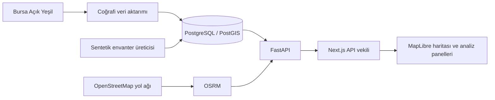

# Mimari ve veri akışı

- `frontend/` Next.js ve TypeScript uygulamasıdır. MapLibre ilçe, mahalle, envanter ve rota katmanlarını çizer. Next.js, arayüzün kullandığı API yollarını aynı origin üzerinden sunar.
- `backend/app/` FastAPI uçlarını, veri aktarımını ve analizleri içerir. `backend/alembic/` veritabanı şemasını sürümler.
- `data/raw/` kaynak anlık görüntülerini ve sentetik üretimde kullanılan yerleşim noktalarını içerir. `scripts/` kaynak inceleme, migration denetimi ve OSRM hazırlama araçlarını içerir.

## Veri modeli

İlçeler ve mahalle analiz alanları çoklu poligon olarak saklanır. Binalar mahallelere, haneler ve işletmeler binalara bağlanır. Hizmet noktaları kategoriye ve mahalleye, bisiklet yolu çizgileri mahalleye bağlanır. Kaynak kimliği, veri türü ve yöntem kayıtların kaynağını izlemeyi sağlar.

Geometriler EPSG:4326 olarak saklanır. PostGIS coğrafi mesafeleri metre cinsinden hesaplar. Alan ve sentetik yerleşim hesaplarında EPSG:32635 kullanılır. Sentetik üretici sabit başlangıç değeriyle çalışır ve kayıtlarını tek işlemde yeniler. [Veri kaynakları ve yöntem](DATA-SOURCES.md)

## Erişim ve senaryo hesapları

API, kuş uçuşu kapsama için PostGIS mesafelerini, tahmini sürüş kapsamı için yerel OSRM süre matrisini kullanır. İtfaiye ve hastane analizinde rota hizmetten haneye hesaplanır. Yol ağı hesabında 250 metre içinde yola bağlanamayan noktalar ve rota bulunamayan haneler eksik ölçüm olarak raporlanır.

Yatırım senaryosu, mevcut hizmet kümesini aynı kümeye bir aday eklenmiş durumla karşılaştırır. Sonuçlar isteğe bağlı hesaplanır ve veritabanına yazılmaz. Kullanıcı akışı ve kurulum [README](README.md) dosyasındadır.
