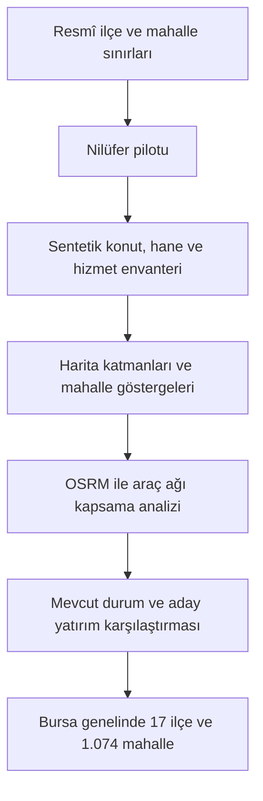

# Bursa Kentsel Zekâ

Bursa’nın 17 ilçesi için geliştirilmiş bağımsız bir kentsel karar destek prototipi. Harita, sentetik envanter ve yol ağı üzerinden hizmete erişimi incelemeyi ve yeni bir hizmet noktasının etkisini karşılaştırmayı sağlar.

- **Kent haritası** ilçelerin sentetik hizmet gelişmişliği puanlarını gösterir. İlçe seçince aynı görünüm mahalle düzeyine iner. Puan, yedi hizmet grubundaki tesis türü çeşitliliğine dayanır. İlçe puanı mahallelerin sentetik nüfusuyla ağırlıklandırılır. Gösterge yalnızca demo envanterini temsil eder.
- **Harita katmanları** konut, ofis ve hizmet kayıtlarını açar. Her sekmede **Tümünü seç** ile kullanılabilir katmanları birlikte açabilirsiniz.
- **Mahalle analizi ve hizmet erişimi** nüfus, envanter ve kapsama sonuçlarını gösterir. Kapsama kuş uçuşu halkalarıyla veya araç ağı üzerinden incelenebilir.
- **Yatırım senaryoları** aday bir hizmet noktasının kapsanan hane ve nüfusa etkisini karşılaştırır ve yatırım bölgeleri önerir.

## İş akışı



1. Resmî sınırlar ve ilçe nüfusları içe alındı. Nilüfer, ilk veri ve uygulama doğrulaması için pilot ilçe olarak seçildi.
2. Mahalle sınırları içinde sentetik konut, hane, ofis ve hizmet kayıtları üretildi. Bina ve hane ilişkileri ile nüfus toplamları doğrulandı.
3. Envanter harita katmanlarına aktarıldı. Mahalle göstergeleri nüfusu, hizmet dağılımını ve sentetik hizmet çeşitliliğini karşılaştırmaya açtı.
4. Kuş uçuşu kapsama halkaları ve OSRM araç ağı hesabı eklendi. Yatırım senaryoları, aday bir hizmet noktasının kapsanan hane ve nüfusa etkisini ölçtü.
5. Nilüfer’de doğrulanan iş akışı Bursa’nın 17 ilçesine ve 1.074 mahalle analiz alanına genişletildi.

## Masaüstünden kurulum

İşletim sisteminize uygun dosyayı indirin ve açın. Dosya projeyi GitHub’dan indirir, Docker çalıştığında uygulamayı ve demo verisini hazırlar ve tarayıcıyı açar. İlk çalıştırma internet bağlantısı gerektirir ve birkaç dakika sürebilir.

| Sistem | Kurulum dosyası |
| --- | --- |
| Windows | [Bursa-Kurulum.cmd](https://raw.githubusercontent.com/utkuBraha/bursa-kentsel-zeka/main/Bursa-Kurulum.cmd) |
| macOS | [Bursa-Kurulum.command](https://raw.githubusercontent.com/utkuBraha/bursa-kentsel-zeka/main/Bursa-Kurulum.command) |

Bağlantı metin olarak açılırsa **Bağlantıyı farklı kaydet** ile dosyayı indirin.

macOS’ta dosyayı indirdikten sonra Terminal’de `chmod +x` yazıp bir boşluk bırakın, dosyayı Terminal’e sürükleyin ve Enter’a basın. Ardından dosyayı açın. Kurulumun seçtiği adres terminalde görünür. Başlatıcı, varsayılan portlar doluysa boş port seçer.

Docker eksikse kurulum dosyası resmî Docker Desktop yükleyicisini indirip açar. İlk kurulum ekranlarını tamamlayın. Windows’ta WSL 2 kurulumu veya yeniden başlatma istenirse, işlemden sonra aynı dosyayı tekrar açın. [Windows için Docker Desktop](https://docs.docker.com/desktop/setup/install/windows-install/) · [macOS için Docker Desktop](https://docs.docker.com/desktop/setup/install/mac-install/)

Başlatıcı 3016, 8000 veya 5433 portu başka bir uygulamada kullanılıyorsa sıradaki boş portu seçer ve `.env` dosyasına yazar. Kurulum sonunda uygulamanın açıldığı adres ekranda gösterilir. Docker Desktop’ta portları görmek için proje satırındaki oka basın. Uygulama adresi `frontend` satırındadır.

Başlatıcı, OpenStreetMap Türkiye verisini indirip Bursa kesitini Docker içinde hazırlar. Harita, araç ağı analizi ve yatırım senaryoları aynı kurulumda açılır. Yol verisi ilk açılışta yüzlerce MB indirir ve hazırlanması bağlantı hızına göre zaman alır. Osmium ve OSRM için masaüstünde ek kurulum gerekmez. [Geofabrik veri kaynağı](https://download.geofabrik.de/europe/turkey.html)

## Fork sonrası kurulum

Git ve Docker Compose gerekir. GitHub’da repoyu fork edin ve aşağıdaki ilk komutta `FORK_URL` yerine kendi fork’unuzun HTTPS klon adresini yazın.

```sh
git clone FORK_URL bursa-kentsel-zeka
cd bursa-kentsel-zeka
cp .env.example .env
docker compose up --build -d --wait
```

`port is already allocated` hatası alırsanız `.env` dosyasında `BURSA_APP_PORT`, `BURSA_API_PORT` veya `BURSA_DB_PORT` değerini boş bir portla değiştirip komutu tekrar çalıştırın. Uygulama adresi `BURSA_APP_PORT` ile birlikte değişir.

İlk açılışta sınırlar ve sentetik envanter hazırlanır. Bu işlem birkaç dakika sürebilir. [Uygulamayı aç](http://127.0.0.1:3016/) · [Yerel API belgeleri](http://127.0.0.1:8000/docs)

## Manuel yol ağı kurulumu

Yerel OSRM kurulumu için `osmium` gerekir. [Geofabrik Türkiye verisini](https://download.geofabrik.de/europe/turkey.html) proje köküne `turkey-latest.osm.pbf` adıyla kaydedin ve komutları sırasıyla çalıştırın.

```sh
mkdir -p data/routing/city
osmium extract -s smart -b 28.0,39.53,30.05,40.66 turkey-latest.osm.pbf -o data/routing/city/bursa.osm.pbf
bash scripts/prepare-routing.sh
docker compose -f docker-compose.yml -f compose.routing.yml up --build -d --wait
```

Sürüş tahminleri mevcut araç ağına dayanır. Sentetik haneler en yakın araç yolu noktasına bağlı kabul edilir. Canlı trafik ve ekip çıkış süresi hesaba katılmaz.

## Veri kaynakları

İlçe nüfusu ve sınırları Bursa Açık Yeşil’e dayanır. Haneler ve hizmet envanterinin büyük bölümü sentetiktir. Yerleşim noktaları ve yol ağı OpenStreetMap verilerine dayanır. [Veri kaynakları ve lisanslar](DATA-SOURCES.md)
